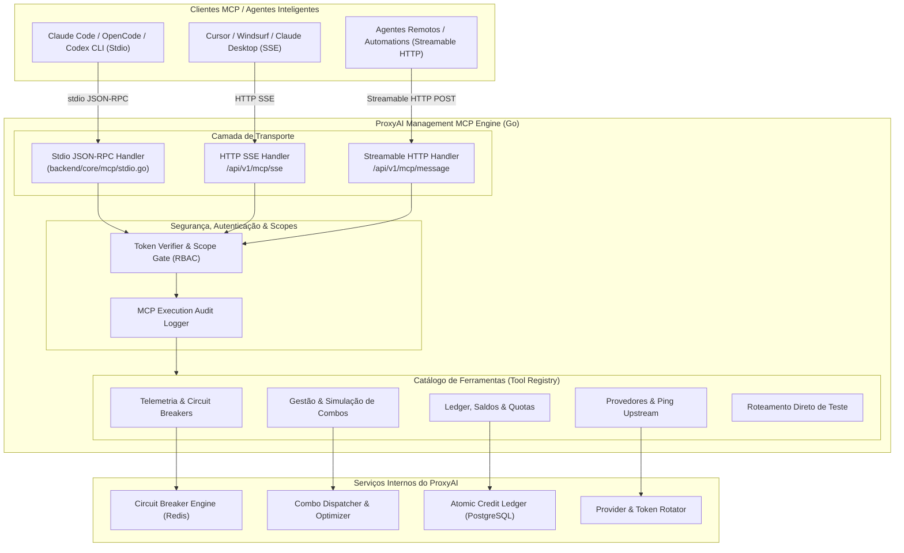

# ADD: ProxyAI Native Management MCP Server

## 1. Visão Geral e Objetivos do MCP Gerencial

O **ProxyAI Management MCP Server** é o servidor padronizado sob a especificação do [Model Context Protocol (MCP)](https://modelcontextprotocol.io/) embutido nativamente no ecossistema do ProxyAI.

Ele permite que agentes inteligentes (Claude Code, OpenCode, Cursor, Roo-Code, Hermes, agentes autônomos e scripts de automação de infraestrutura) interajam **diretamente com a inteligência do gateway**, desempenhando duas funções vitais:
1. **Governança & Administração do Gateway:** Gerenciar e alternar combos, cadastrar e rotacionar provedores upstream, consultar status dos circuit breakers em tempo real, monitorar saldos pré-pagos e gerenciar chaves virtuais de clientes.
2. **Operações de Roteamento & Telemetria:** Simular rotas de modelos para estimar custos antes de chamadas caras (`proxyai_simulate_route`), auditar latências p95 de provedores e disparar sondas canary (`proxyai_test_provider`).

---

## 2. Lições Aprendidas do OmniRoute e 9Router aplicadas ao ProxyAI

| Requisito | Como OmniRoute / 9Router Fazem | Como o ProxyAI Inova & Corrige |
| :--- | :--- | :--- |
| **Transportes Suportados** | Stdio e SSE em Node.js. O OmniRoute adiciona Streamable HTTP. | Suporte nativo em Go aos 3 transportes: **Stdio** (local CLI sem overhead de rede), **SSE** (HTTP Server-Sent Events) e **Streamable HTTP** (POST com streaming chunked). |
| **Pureza de Stdio (JSON-RPC)** | OmniRoute precisa de um guard (`mcpStdioConsoleGuard.mjs`) para evitar que logs de banco poluam o stdout do protocolo. | Go escreve logs exclusivamente no `os.Stderr`, mantendo o `os.Stdout` puramente dedicado a frames JSON-RPC válidos, garantindo zero quebra de handshake. |
| **Segurança & RBAC (Scopes)** | Sistema robusto de 33 escopos (ex.: `read:health`, `write:combos`, `read:usage`). | Adoção do modelo de **Least-Privilege Token Scopes**: cada chave MCP tem permissões granulares mapeadas para evitar que agentes executem ações destrutivas acidentalmente. |
| **Latência de Acesso** | No OmniRoute / 9Router, as ferramentas MCP importam diretamente os repositórios SQLite locais. | No ProxyAI, o MCP Server em Go acessa o Redis (circuit breakers e cache) e PostgreSQL em memória/pool local sem fazer requests HTTP loopback. |

---

## 3. Diagrama de Arquitetura do MCP Server (Mermaid)



---

## 4. Catálogo de Ferramentas Gerenciais (ProxyAI MCP Tools)

### A. Saúde, Telemetria & Circuit Breakers
| Ferramenta | Escopo Obrigatório | Descrição |
| :--- | :--- | :--- |
| `proxyai_get_health` | `read:health` | Retorna o status geral do gateway, métricas de memória, taxa de requisições e versão. |
| `proxyai_list_circuit_breakers` | `read:health` | Lista o estado dos circuit breakers de todos os provedores (`CLOSED`, `DEGRADED`, `OPEN`, `HALF_OPEN`) com taxa de falha e latência p95. |
| `proxyai_reset_circuit_breaker` | `write:resilience` | Força a redefinição de um circuito aberto para `HALF_OPEN` ou `CLOSED`, permitindo novas tentativas manuais. |

### B. Gestão de Combos & Roteamento Inteligente
| Ferramenta | Escopo Obrigatório | Descrição |
| :--- | :--- | :--- |
| `proxyai_list_combos` | `read:combos` | Lista todos os combos configurados, modelos encadeados e suas respectivas estratégias de failover. |
| `proxyai_get_combo_metrics` | `read:combos` | Retorna o histórico de economia projetada, taxa de sucesso e latência de um combo específico. |
| `proxyai_create_or_update_combo`| `write:combos` | Cria ou altera um combo definindo alvos, timeouts, fallbacks e estratégia (`priority`, `cost-optimized`, `headroom`, `fusion`). |
| `proxyai_simulate_route` | `read:combos` | Simula para qual provedor uma requisição hipotética seria enviada, informando o custo estimado e fatores de decisão. |

### C. Provedores & Autenticação
| Ferramenta | Escopo Obrigatório | Descrição |
| :--- | :--- | :--- |
| `proxyai_list_providers` | `read:providers` | Lista provedores upstream ativos, tipos de credencial (API Key, OAuth, Web) e expiração de tokens. |
| `proxyai_test_provider` | `read:providers` | Executa um teste de sonda (canary ping) de 1 token e retorna a latência exata e status HTTP. |
| `proxyai_refresh_oauth_token` | `write:providers` | Força a renovação antecipada do token OAuth de um provedor (ex.: Claude ou Gemini CLI). |
| `proxyai_recycle_browser_pool` | `write:providers` | Reinicializa instâncias do pool do Playwright no sidecar web para renovar fingerprints e cookies. |

### D. Faturamento, Quotas & Ledger
| Ferramenta | Escopo Obrigatório | Descrição |
| :--- | :--- | :--- |
| `proxyai_get_billing_summary` | `read:billing` | Consulta saldo pré-pago disponível, reservas ativas no Redis (holds) e percentual de cota de plano. |
| `proxyai_audit_ledger` | `read:billing` | Consulta as últimas $N$ transações imutáveis de débito/crédito do usuário com contagem real de tokens in/out. |

---

## 5. Implementação Técnica em Go

O servidor MCP será implementado como um pacote nativo dentro do Data Plane em Go:
- Localização: `backend/core/pkg/mcp/`
- Modo CLI: O binário compilado do ProxyAI aceitará o comando `proxyai mcp` para execução instantânea via Stdio no `~/.opencode.json` ou `claude_desktop_config.json`:
  ```json
  {
    "mcpServers": {
      "proxyai": {
        "command": "proxyai",
        "args": ["mcp"],
        "env": {
          "PROXYAI_API_KEY": "pk_admin_master_..."
        }
      }
    }
  }
  ```
- Pureza de Stdio: Garantida nativamente em Go configurando `log.SetOutput(os.Stderr)`. O canal `os.Stdout` responderá unicamente aos pacotes codificados em JSON-RPC 2.0.
