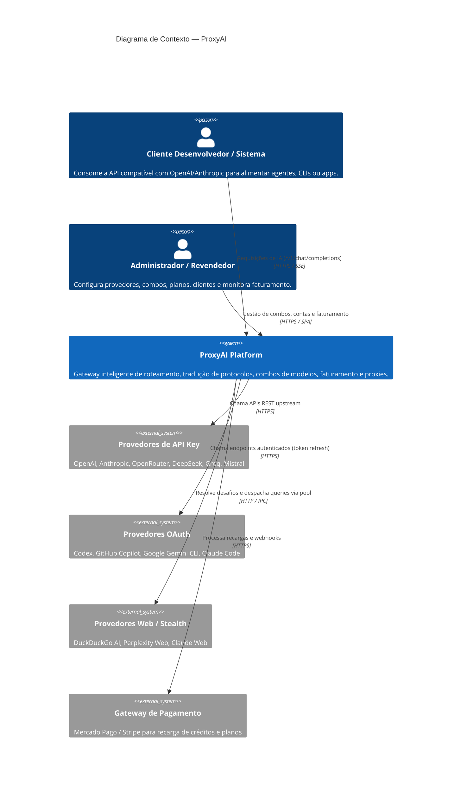
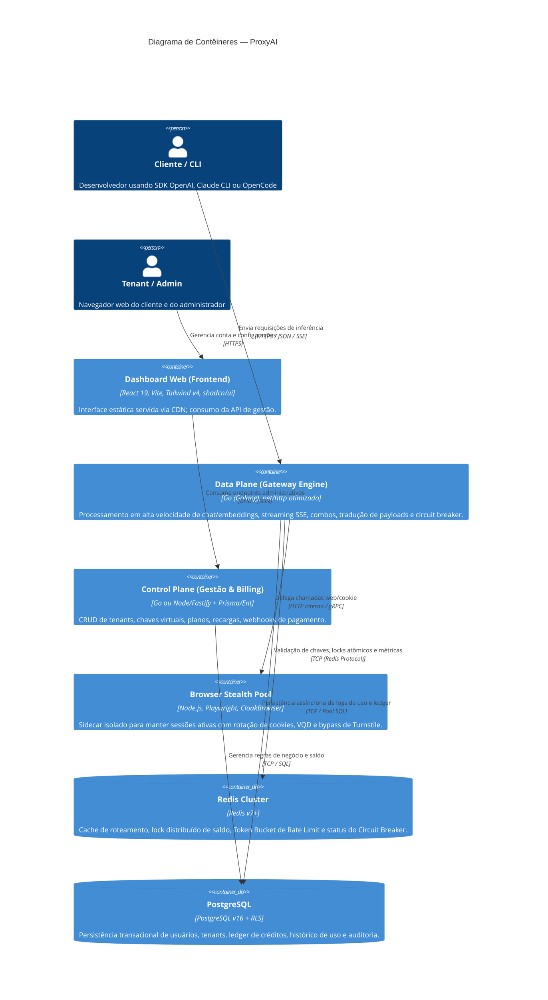

# Architecture Design Document (ADD) — ProxyAI

## 1. Visão Geral e Objetivos do Sistema

O **ProxyAI** é um gateway de inteligência artificial de alta disponibilidade e ultrabaixa latência, projetado para unificar provedores de IA públicos (gratuitos), corporativos (pagos via API Key), contas com autenticação OAuth e provedores baseados em Web/Session Cookies (via browser stealth).

O sistema foi desenhado para **comercialização multi-tenant**, permitindo vender acesso a modelos de IA com precificação personalizada, cotas recorrentes (planos) e créditos pré-pagos sob demanda com reconciliação atômica de saldo (Token Ledger).

### Requisitos Não-Funcionais Críticos (NFRs)
- **Latência de Proxy (TTFT - Time To First Token):** Overhead de roteamento menor que 5ms para requisições com cache quente e resolução de combo.
- **Concorrência e Streaming:** Backend capaz de sustentar milhares de conexões Server-Sent Events (SSE) simultâneas com consumo mínimo de memória.
- **Resiliência Multi-Camada:** Circuit breakers por provedor (Closed, Degraded, Open, Half-Open), mitigação de rate limit (429) e chaveamento automático em cadeias de fallback (Combos).
- **Isolamento de Recursos:** Provedores baseados em emulação de navegador (Playwright/Turnstile) isolados em sidecars para proteção contra exaustão de CPU/RAM no Data Plane.
- **Precisão Financeira:** Prevenção absoluta de estouro de saldo (Race Conditions em saldo pré-pago) através de reserva de cota atômica e conciliação pós-stream.

---

## 2. Diagramas C4 (Mermaid)

### 2.1 C4 Nível 1: Diagrama de Contexto

### 2.2 C4 Nível 2: Diagrama de Contêineres

---

## 3. Modelo de Domínio e Faturamento (Ledger Financeiro)

### Prevenção de Race Condition em Saldo Pré-Pago
No streaming SSE, o número exato de tokens de saída (*completion tokens*) só é conhecido ao final da requisição. Para permitir cobrança comercial sem risco de calote:
1. **Reserva Estimada (Pre-flight Hold):** O Data Plane verifica o saldo disponível e cria um *hold* atômico no Redis (`DECRBY user:balance:reserved <valor_estimado>`).
2. **Execução Streaming:** O fluxo SSE corre diretamente para o cliente enquanto tokens são contabilizados na passagem dos chunks.
3. **Liquidação Efetiva (Post-flight Settlement):** Ao receber o chunk final com `finish_reason` ou fechamento de stream, calcula-se o custo exato (preço de entrada + preço de saída + margem de lucro). O hold é liberado e o débito real é persistido no PostgreSQL (Tabela `credit_ledger`).

---

## 4. Engenharia de Combos e Resiliência

Inspirado nas 19 estratégias do OmniRoute, o ProxyAI suportará nativamente no Data Plane em Go:
- **Priority / Failover Sequencial:** Tenta o modelo A (ex.: DeepSeek gratuito/local). Se retornar 429/500/timeout, faz failover imediato para o modelo B (ex.: OpenAI/Claude pago).
- **Cost-Optimized:** Prioriza automaticamente os provedores de menor custo com taxa de sucesso superior a 98% na janela deslizante de 5 minutos.
- **Headroom / Reset-Aware:** Monitora janelas de rate limit informadas pelos headers upstream (`x-ratelimit-reset`, `retry-after`) e pula preventivamente provedores bloqueados.
- **Circuit Breakers Atômicos:** 
  - `CLOSED`: Provedor saudável.
  - `DEGRADED`: Taxa de erro > 15% (aciona alertas).
  - `OPEN`: Taxa de erro > 40% (desliga provedor da rota por N segundos sem tentar requisições).
  - `HALF_OPEN`: Permite sonda pontual (canary request) para testar recuperação.

---

## 5. Estratégia de Autenticação com Provedores

1. **API Key Pura:** Injeção direta de `Bearer <key>` ou cabeçalhos proprietários (`x-api-key`).
2. **OAuth com Auto-Refresh Pró-Ativo:** O serviço armazena `refresh_token` criptografado e renova o token automaticamente antes da expiração (ex.: Codex com tolerância de 8 dias).
3. **Web Cookie & Session Pool (Sidecar):**
   - Pool de instâncias Playwright isoladas mantendo páginas em background.
   - Headers e fingerprints consistentes gerados para contornar checagens de integridade e proteções anti-bot.

---

## 6. MCP Gerencial Integrado (Model Context Protocol)

O ProxyAI incorpora um servidor MCP nativo de gestão em Go (`backend/core/pkg/mcp/`) compatível com Stdio, SSE e Streamable HTTP.
- **Função:** Permitir que agentes como Claude Code, OpenCode e Cursor gerenciem combos, auditem circuit breakers, consultem extratos de ledger e simulem rotas programaticamente.
- **Segurança:** RBAC granular com escopos (`read:health`, `write:combos`, `read:billing`, `write:providers`).
- **Pureza de Stdio:** Logs do sistema emitidos exclusivamente para `os.Stderr`, mantendo o `os.Stdout` dedicado a payloads JSON-RPC 2.0 puros.
- Detalhamento completo em [`docs/architecture/ADD-mcp-server.md`](./ADD-mcp-server.md).

---

## 7. Subsistema de Colaboradores e Login para OpenCode

Permite que empresas clientes concedam acessos nomeados aos seus times de desenvolvimento no OpenCode (CLI e Desktop):
1. **Credenciais Individuais & Página de Gestão:** O gestor dispõe de uma página dedicada (`/collaborators/new`) para cadastrar desenvolvedores, atribuir squads/cargos e definir matrizes de acesso a modelos.
2. **Login no OpenCode:** O desenvolvedor executa `opencode auth login --proxy <url_proxy> --tenant <slug>` para autenticar via usuário e senha ou Device Flow.
3. **Controle de Cotas Multi-Janela:** Cada membro e cada empresa possuem limites atômicos em 3 horizontes:
   - **Janela de 5 Horas:** Proteção anti-burst e anti-loops de agentes.
   - **Janela Semanal:** Distribuição balanceada no ciclo.
   - **Janela Mensal:** Teto máximo contratado.
4. **Governança no Data Plane:** Validação em múltiplos níveis no Redis (Cotas 5h, semanais e mensais do Tenant + Membro) em <0.5ms com resposta informativa em caso de corte (HTTP 429 com `Retry-After`).
