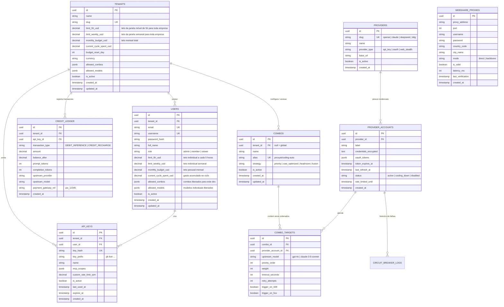

# Diagrama Entidade-Relacionamento (DER) — ProxyAI

> **Banco de Dados Relacional:** PostgreSQL 16+ com Row-Level Security (RLS)  
> **Camada de Cache & Locks:** Redis 7+

---

## 1. Diagrama DER Visual (Mermaid)



---

## 2. Estratégia de Índices e Otimização contra N+1

1. **`idx_api_keys_lookup`:** Índice B-Tree composto em `API_KEYS (key_hash, is_active)` para autenticação em O(1).
2. **`idx_ledger_tenant_history`:** Índice particionado em `CREDIT_LEDGER (tenant_id, created_at DESC)` para extração ultra rápida de extratos sem full scan.
3. **`idx_combo_targets_ordered`:** Índice em `COMBO_TARGETS (combo_id, priority_order ASC)` com prefetch em eager loading no Data Plane para evitar queries sequenciais N+1.
4. **`idx_webshare_routing`:** Índice em `WEBSHARE_PROXIES (is_valid, mode, country_code, latency_ms ASC)` para seleção rápida do melhor proxy em <1ms.

---

## 3. Políticas de Isolamento Multitenant (Row-Level Security - RLS)

```sql
-- Habilitar RLS nas tabelas pertencentes ao Tenant
ALTER TABLE api_keys ENABLE ROW LEVEL SECURITY;
ALTER TABLE credit_ledger ENABLE ROW LEVEL SECURITY;
ALTER TABLE combos ENABLE ROW LEVEL SECURITY;

-- Política de Leitura e Escrita baseada na Sessão Atual do Tenant
CREATE POLICY tenant_isolation_api_keys ON api_keys
  FOR ALL
  USING (tenant_id = NULLIF(current_setting('app.current_tenant_id', true), '')::uuid);

CREATE POLICY tenant_isolation_ledger ON credit_ledger
  FOR SELECT
  USING (tenant_id = NULLIF(current_setting('app.current_tenant_id', true), '')::uuid);

-- Superusuários e Administradores Globais possuem Bypass de RLS via role específica do PostgreSQL
```
