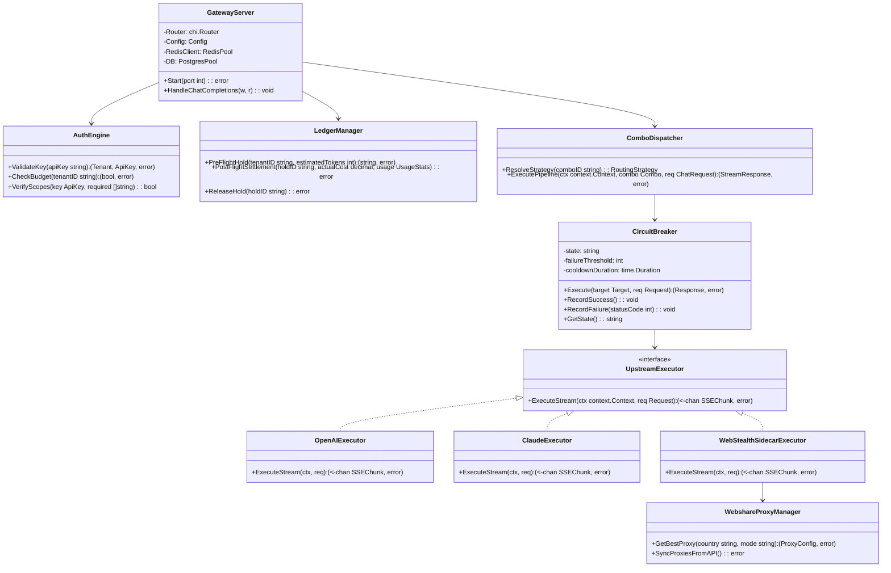
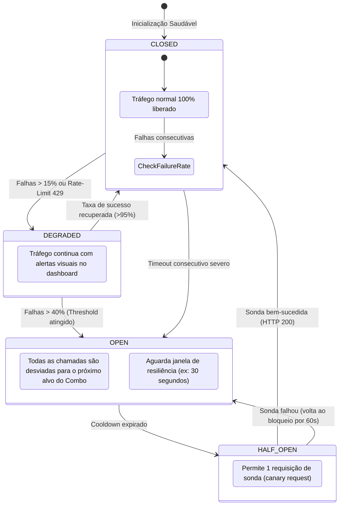
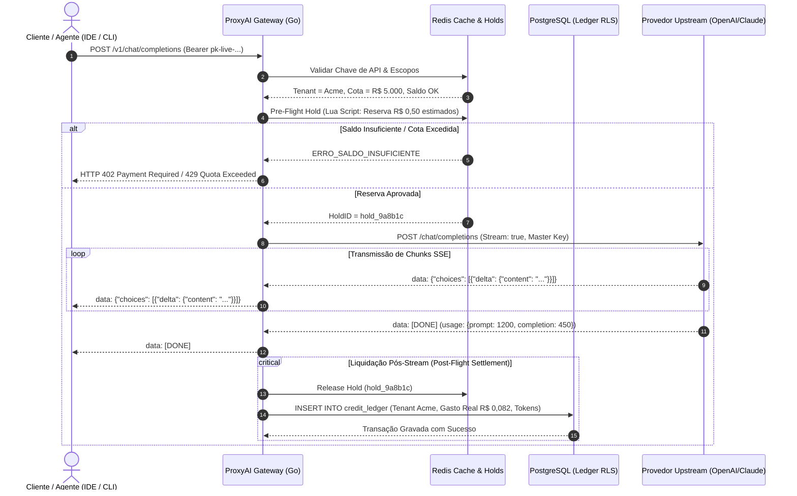

# Diagramas UML de Arquitetura e Engenharia — ProxyAI

---

## 1. Diagrama de Classes e Componentes do Data Plane (Go)

---

## 2. Diagrama de Máquina de Estados: Circuit Breaker de Provedores

---

## 3. Diagrama de Sequência: Fluxo Ponta-a-Ponta com Pre-Flight Hold e Streaming SSE

